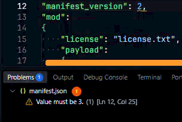
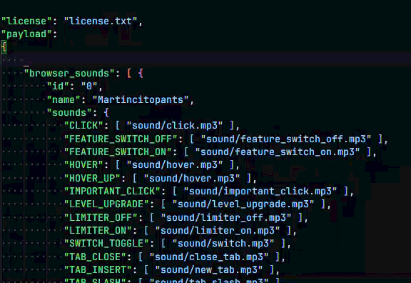
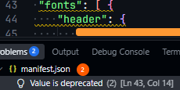

# Opera GX Mods (opera-gx-mods) README
An extension that inclused everything you need to develop Opera GX Mods!

## Features
### - Manifest validation
Automatically check that your `manifest.json` complies with the structure Opera GX accepts and requires.

### - Snippets
Try typing `theme`, `browser_sounds`, etc for templates (snippets) that make it easy to populate your addon manifest by tabbing through.

## Known Issues
If you encounter a `deprecated` value, this signifies that the value is valid, and will work if you install the mod directly, but the Opera GX store reserves those for official mods.

## Release Notes

### 1.0.0
First release
